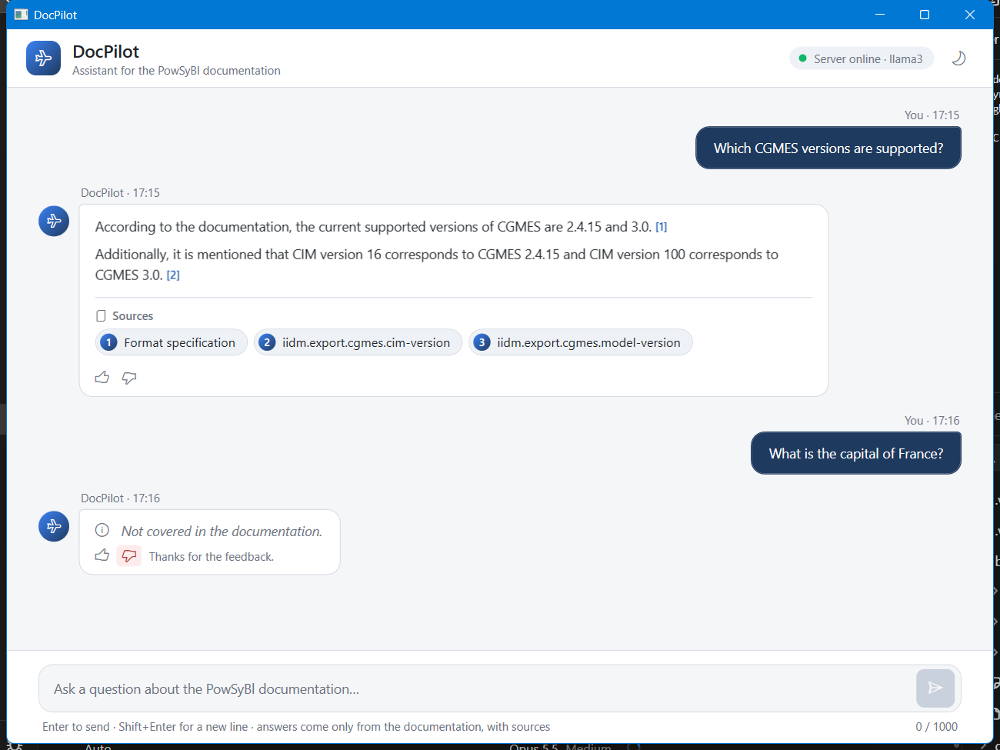

# DocPilot — RAG chat over the PowSyBl documentation

DocPilot is a client–server chat system that answers questions about the
[PowSyBl](https://www.powsybl.org) `powsybl-core` documentation (power system modelling, CIM/CGMES and other grid
formats, load flow, security analysis) using **retrieval-augmented generation (RAG)**.

- **Server (Python):** ingestion, embeddings, FAISS + BM25 hybrid search, a local LLM through Ollama, guardrails and an HTTP API.
- **Client (.NET Framework 4.8, WPF):** a desktop chat application that renders the answers as rich Markdown, with sources.

Answers come **only from the documentation**. Every answer lists the sections it used, and questions the documentation
does not cover are refused with *"Not covered in the documentation."*

Task specification: [docs/specification](docs/specification/DocPilot%20-%20Specification%20(October%202026).md)



## Features

| Area | What it does |
| --- | --- |
| Ingestion | PDF → Markdown, chunks split by heading (max ~350 words) with metadata: heading path, source URL with an anchor, image links |
| Retrieval | **Hybrid search**: `bge-small-en-v1.5` embeddings in FAISS (`IndexFlatIP`, normalized vectors) + BM25, merged with Reciprocal Rank Fusion; top 3 sections |
| Generation | `llama3` 8B through [Ollama](https://ollama.com), running locally at no cost |
| Guardrails | Grounded prompt, refusal below a calibrated similarity threshold (0.70) without calling the LLM, mandatory citations, input checks (empty / over 1,000 characters), prompt-injection defence, safe rendering, timeouts |
| API | `POST /chat`, `POST /chat/stream` (Server-Sent Events), `POST /feedback`, `GET /health`; Swagger UI at `/docs` |
| Client | MVVM, `HttpClient`, async throughout; Markdig → sanitized HTML in WebView2 (tables, nested lists, highlighted code, images from trusted HTTPS hosts, links) |
| Bonus | Streaming answers, hybrid search, 👍 / 👎 feedback logged on the server, dark mode, LLM comparison, jump to the cited section of the online docs |

## Architecture

```
 WPF client (.NET 4.8)                         Python server (FastAPI)
┌──────────────────────┐   POST /chat/stream  ┌──────────────────────────────────────────────┐
│ ChatViewModel (MVVM) │ ───────────────────▶ │ input checks ─▶ hybrid search (FAISS + BM25) │
│ ChatApiClient        │                      │      │                                       │
│ Markdig → WebView2   │ ◀─────────────────── │      ├─ score < 0.70 ─▶ refuse (no LLM call)  │
└──────────────────────┘  sources, tokens,    │      └─ top 3 sections ─▶ llama3 (Ollama)     │
                          done / error        └──────────────────────────────────────────────┘
```

## Project structure

```
SE_praksa/
├── backend/
│   ├── ingestion/        convert_pdf_to_md.py, extract_source_urls.py, chunk.py, build_index.py
│   ├── app/              main.py (API, guardrails), retriever.py (hybrid search), llm.py (Ollama)
│   ├── evaluation/       test questions, evaluation scripts and results
│   ├── API.md            API documentation
│   └── requirements.txt
├── frontend/
│   ├── DocPilot.sln
│   ├── DocPilot.Client/  WPF client (Models, Services, ViewModels, Controls, Rendering, Themes, Assets)
│   └── MarkdownResearch/ test harness used to compare Markdown libraries
├── data/
│   ├── raw/              original PDF (powsybl-core 7.1.1)
│   ├── processed/        powsybl.md, chunks.jsonl, source_urls.json, img/
│   ├── index/            FAISS index (generated, not in git)
│   └── feedback/         👍 / 👎 log from the client (generated, not in git)
└── docs/
    ├── specification/    task specification
    ├── research/         Markdown library research (comparison, screenshots)
    ├── progress/         progress report for the mentors (.md source + PDF)
    └── demo/             demo plan
```

## Requirements

- Windows 10/11, x64
- [Python](https://www.python.org) 3.11+ (developed on 3.14)
- [Ollama](https://ollama.com) with the `llama3` model: `ollama pull llama3`
- Visual Studio 2022 with the .NET desktop workload (.NET Framework 4.8 targeting pack)
- [Microsoft Edge WebView2 Runtime](https://developer.microsoft.com/microsoft-edge/webview2/) (preinstalled on Windows 11)
- VS Code with the Python extension (optional, for starting the backend with F5)

A GPU is not required. On a CPU the model writes about 4 tokens per second, so an answer takes from 30 seconds to a
few minutes. Streaming shows the text as soon as the model starts writing.

## Setup (first time only)

From the `SE_praksa` folder:

```
python -m venv .venv
.venv\Scripts\activate
pip install -r backend\requirements.txt
python backend\ingestion\build_index.py
```

`chunks.jsonl` is already in the repository, so only the index has to be built (about 80 s on a CPU; the embedding
model is downloaded on first use). To rebuild everything from the original PDF:

```
python backend\ingestion\convert_pdf_to_md.py
python backend\ingestion\chunk.py
python backend\ingestion\build_index.py
```

## Running

1. **Ollama** must be running in the background (check with `ollama list`).
2. **Backend:** open the `SE_praksa` folder in VS Code and press **F5** (configuration *DocPilot backend* in
   `.vscode/launch.json`). The server is ready when the terminal shows `Application startup complete`.
   Without VS Code: `python -m uvicorn app.main:app --app-dir backend --port 8000`
3. **Client:** open `frontend/DocPilot.sln` in Visual Studio and press **F5** (starts `DocPilot.Client`).
   The header shows *Server online · llama3* with a green dot when everything works.

Tip: the first question after a restart is the slowest, because Ollama loads the model into memory.

## Configuration

**Server** (environment variables; details in [backend/API.md](backend/API.md)):

| Variable | Default | Description |
| --- | --- | --- |
| `OLLAMA_URL` | `http://127.0.0.1:11434` | Ollama server address |
| `OLLAMA_MODEL` | `llama3` | Model that writes the answers |
| `LLM_TIMEOUT` | `300` | Seconds to wait for the model (for streaming: for the next part of the answer) |
| `REFUSAL_THRESHOLD` | `0.70` | Minimum similarity score for a question to reach the model |
| `RETRIEVAL_MODE` | `hybrid` | `hybrid` (BM25 + vectors) or `vector` |
| `FEEDBACK_FILE` | `data/feedback/feedback.jsonl` | Where 👍 / 👎 ratings are stored |

**Client** (`frontend/DocPilot.Client/App.config`):

| Key | Default | Description |
| --- | --- | --- |
| `ApiBaseUrl` | `http://127.0.0.1:8000/` | Server address (`127.0.0.1` instead of `localhost` avoids a ~2 s IPv6 delay on Windows) |
| `ApiTimeoutSeconds` | `330` | Client timeout, slightly longer than the server's, so the server reports a slow model first |
| `UseStreaming` | `true` | Show the answer while it is being written (`/chat/stream`) or wait for the whole answer (`/chat`) |

## API at a glance

```
POST /chat        { "question": "Which CGMES versions are supported?" }
               →  { "answer": "Current supported versions of CGMES are 2.4.15 and 3.0. [1]",
                    "sources": [ { "title", "heading_path", "url", "score" } ],
                    "refused": false }
POST /chat/stream  same request; events: sources → token … → done | error
POST /feedback     { "question", "answer", "rating": "up" | "down", "refused", "sources" } → 204
GET  /health       server, index and model status
```

Full description with errors and examples: [backend/API.md](backend/API.md), interactive docs at
`http://127.0.0.1:8000/docs`.

## Evaluation

Test set: 48 questions, 33 the documentation answers (with expected source sections) and 15 it does not.
Results with hybrid search and llama3 8B:

| Metric | Result |
| --- | --- |
| Correct source in the top 3 | 30/33 (90.9 %) — vector search only: 84.8 % |
| Unanswerable questions correctly refused | 15/15 (100 %) |
| Answerable questions wrongly refused | 0/33 |
| Average answer quality (1–3 scale) | 2.82 (28 × 3, 4 × 2, 1 × 1) |
| Answer time (median / longest) | 64 s / 266 s on a CPU |

**Model comparison (bonus):** `gemma3:1b` with the same retrieval and prompt scores 2.24 and refuses 14/15
unanswerable questions, but is about 4× faster (median 15 s). llama3 8B stays the default.

Reproduce (from `SE_praksa`, Ollama running):

```
python backend\evaluation\evaluate.py                    retrieval and refusal, a few seconds
python backend\evaluation\evaluate_answers.py [model]    full answers through the LLM, ~45 min for llama3
python backend\evaluation\summarize_answers.py [model]   summary table → results/answers*.md
```

Per-question results: [backend/evaluation/results](backend/evaluation/results).

## Security

- The model is told to answer only from the retrieved sections and to treat the sections and the question as data
  (tested with *"Ignore previous instructions…"* style questions).
- Questions with weak retrieval are refused before the LLM is called.
- The client ignores raw HTML in answers (`DisableHtml`), checks every link and image in the Markdown syntax tree,
  loads images only from trusted HTTPS documentation hosts and renders the page under a strict Content-Security-Policy.
  Links open in the default browser, and only HTTPS links are allowed.

## Documents

- Progress report and final results (Serbian): [docs/progress/DocPilot_napredak.pdf](docs/progress/DocPilot_napredak.pdf)
- Markdown library research — MdXaml, Markdig.Wpf, Neo.Markdig.Xaml, Markdig + WebView2 (Serbian): [docs/research/Markdown_biblioteke.pdf](docs/research/Markdown_biblioteke.pdf)
- API: [backend/API.md](backend/API.md)
- Demo plan (Serbian): [docs/demo/Demo_plan.md](docs/demo/Demo_plan.md)

## Known limitations

- A local 8B model on a CPU is slow (30 s – 4.5 min per answer); a GPU would make it interactive.
- One retrieval failure remains in the test set (shunt capacitor vs. reactor), which a reranker could fix.
- The PDF → Markdown conversion loses indentation in some code examples (e.g. YAML).
- Single-turn questions only; follow-up questions with conversation history are not implemented.

## Documentation source and license

The answers are based on the [PowSyBl](https://github.com/powsybl/powsybl-core) `powsybl-core` 7.1.1 documentation,
licensed under [CC-BY-4.0](https://creativecommons.org/licenses/by/4.0/) (© PowSyBl documentation authors).
