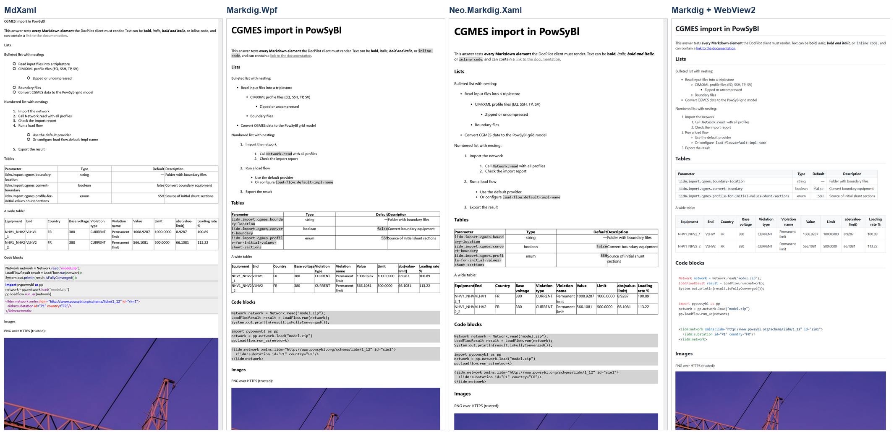

# Istraživanje Markdown biblioteka za WPF klijent

DocPilot · klijent: .NET Framework 4.8 + WPF · test: `docs/research/test.md` · test aplikacija: `frontend/MarkdownResearch`

## Poređenje

Isti test fajl (naslovi, ugnežđene liste, tabele, kod, PNG i SVG slike, HTTP slika, sirovi HTML, linkovi) prikazan je u sve četiri biblioteke u istoj net48 WPF aplikaciji. Ocene 1–5 su date na osnovu screenshot-ova i merenja, a podaci o održavanju sa NuGet-a i GitHub-a (15.10.2026).

| Kriterijum | MdXaml 1.27.0 | Markdig.Wpf 0.5.0.1 | Neo.Markdig.Xaml 1.0.10 | Markdig 1.4.0 + WebView2 |
| --- | --- | --- | --- | --- |
| .NET Framework 4.8 | 5 — radi | 5 — radi (i sa Markdig 1.4) | 5 — radi | 5 — radi (x64 build) |
| Tabele | 4 — okviri, poravnanje; široka tabela se lomi | 4 — okviri, poravnanje; široka se lomi | 4 — isto | 5 — stil, poravnanje, horizontalni skrol |
| Slike (HTTPS) | 3 — PNG i SVG (dodatak), ali SVG ostavlja veliki prazan prostor | 2 — PNG da, **SVG se ne prikazuje** | 2 — PNG da, **SVG ne** | 5 — PNG i SVG |
| Liste | **2 — ugnežđene liste sa 2–3 razmaka se pogrešno čitaju** | 5 | 5 | 5 |
| Kod blokovi | 4 — bojenje sintakse; sa SVG dodatkom gubi monospace | 2 — monospace, bez boja | 2 — monospace, bez boja | 5 — bojenje (highlight.js) |
| Stil | 2 — sa dodacima nestaje stil naslova | 3 | 3 | 4 — CSS, odvojen od WPF stilova |
| Održavanje | 3 — stabilna verzija 2024, prerelease 2026 | **1 — repo arhiviran 2024** | 2 — poslednja verzija 2021 | 5 — obe aktivne (sep 2026) |
| Licenca | 5 — MIT | 5 — MIT | 5 — Apache-2.0 | 5 — BSD-2 / BSD-style |
| Performanse (dug odgovor*) | 3 — UI blokiran 230–475 ms | 3 — 202–378 ms | 4 — 102–211 ms | 5 — UI blokiran 3–26 ms, prikaz 233–409 ms |
| Bezbedan prikaz | 2 — HTML prikazan iskrivljeno, HTTP slika učitana | 3 — HTML kao tekst, HTTP slika učitana | 3 — isto | 5 — HTML kao tekst, HTTP slika blokirana (CSP) |
| **Ukupno (od 50)** | **33** | **33** | **35** | **49** |

\* ~2.800 reči, 24 kod bloka, 16 tabela; medijana 5 merenja u 4 nezavisna pokretanja. Kod FlowDocument biblioteka sav posao radi UI nit; kod WebView2 UI nit samo pretvori Markdown u HTML, a prikaz radi poseban Edge proces.

## Izbor: Markdig + WebView2

**Zašto:**

1. **Jedina opcija koja je ispravno prikazala ceo test fajl** — uključujući ugnežđene liste, SVG dijagrame iz PowSyBl dokumentacije (skoro sve slike u dokumentaciji su SVG), široke tabele i obojen kod.
2. **UI se ne zamrzava.** UI nit je blokirana 3–26 ms, naspram 100–475 ms kod ostalih, što je bitno jer specifikacija traži da UI nikada ne zamrzne.
3. **Bezbedan prikaz se rešava standardnim alatima:** Markdig `DisableHtml()` pretvara sirovi HTML u običan tekst, a Content-Security-Policy dozvoljava slike samo sa `https://powsybl.readthedocs.io` i `https://www.powsybl.org`. FlowDocument biblioteke nemaju mehanizam za blokiranje slika po adresi (proveren je i MdXaml — `LoadImage` se ne može preklopiti), pa bi se adrese morale filtrirati ručno pre prikaza.
4. **Najbolje održavanje:** Markdig (~80 miliona preuzimanja) i WebView2 (Microsoft) su aktivni, a Markdig.Wpf je arhiviran.

**Cena izbora i kako je rešavamo:**

| Problem | Rešenje u klijentu |
| --- | --- |
| Potreban WebView2 Runtime | Na Windows 11 je deo sistema; za starije sisteme Microsoft daje instalaciju (Evergreen bootstrapper) |
| WebView2 je nativna x64 komponenta | Projekat se gradi za x64 |
| „Airspace“: WebView2 je poseban prozor i ne slaže se sa WPF elementima preko sebe i sa skrolovanjem liste | Ceo razgovor se prikazuje u jednom WebView2 (poruke se dodaju preko JavaScript-a), ili se koristi `WebView2CompositionControl` |
| Poseban Edge proces troši više memorije i treba mu vremena za start | Jedna instanca za ceo razgovor, napravljena pri pokretanju aplikacije |
| highlight.js se u testu učitava sa CDN-a | U klijentu se pakuje lokalno, bez interneta i bez spoljnih skripti |

**Rezerva:** Neo.Markdig.Xaml ili Markdig.Wpf, ako WebView2 ne bi bio dozvoljen na ciljnim računarima — ali bez SVG slika i bojenja koda, uz ručno filtriranje slika.

## Šta je test pokazao po biblioteci

**MdXaml** — sopstveni parser (izveden iz MarkdownSharp-a, nije CommonMark). Ugnežđene liste uvučene sa 2–3 razmaka (kako ih pišu LLM-ovi) postaju stavke prvog nivoa, pa numeracija 1.1, 1.2 postaje 2, 3. Kada se doda dodatak za SVG, nestaje stil naslova i monospace font koda. Sirovi HTML se prikazuje kao delimično iskrivljen tekst (npr. `script>alert`).

**Markdig.Wpf** — ispravan CommonMark (koristi Markdig), uredne liste i tabele. SVG slika se ne prikazuje (ostaje prazno mesto), kod je bez boja, HTTP slika se učitava. Repozitorijum je arhiviran.

**Neo.Markdig.Xaml** — gotovo isti rezultat kao Markdig.Wpf, najbrža od FlowDocument biblioteka, ali bez SVG-a i bojenja koda; poslednja verzija iz 2021.

**Markdig + WebView2** — sve ispravno: naslovi, liste, tabele sa skrolom, obojen kod, PNG i SVG; HTTP slika je blokirana (prikazan je samo alternativni tekst), sirovi HTML prikazan kao tekst.

## Screenshot-ovi

Gornji deo test fajla (tekst, liste, tabele, kod) u sve četiri biblioteke:



Celi screenshot-ovi su u `docs/research/screenshots/`: `mdxaml.png`, `markdig-wpf.png`, `neo-markdig-xaml.png`, `markdig--webview2.png`. Merenja su u `results.csv`.

**Ponavljanje testa** (iz `SE_praksa`):

```
dotnet run --project frontend/MarkdownResearch -c Release -- docs/research/test.md docs/research/screenshots
```
